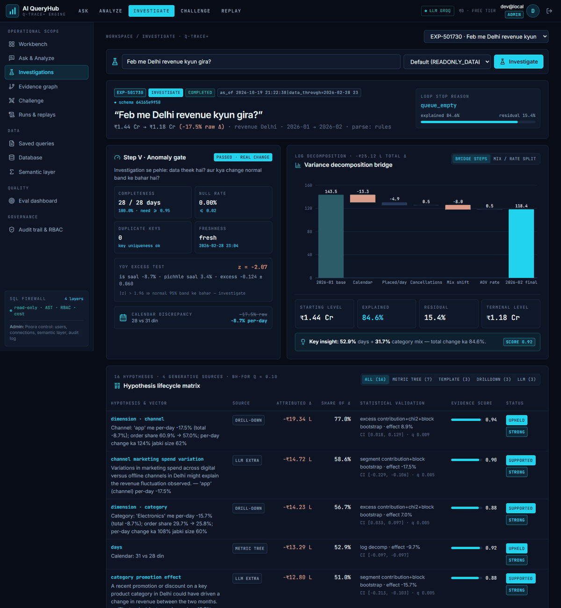
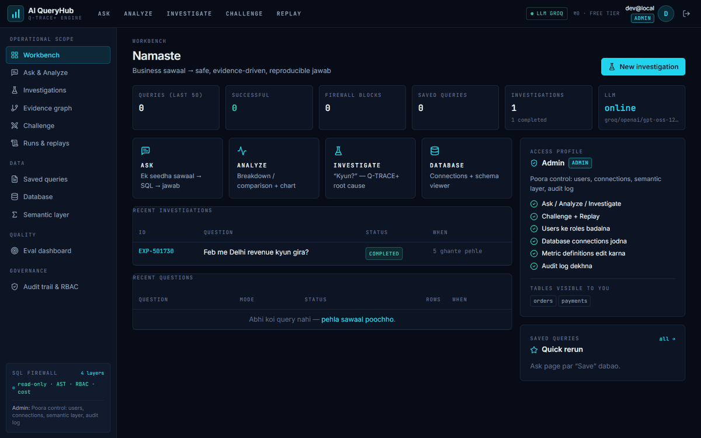
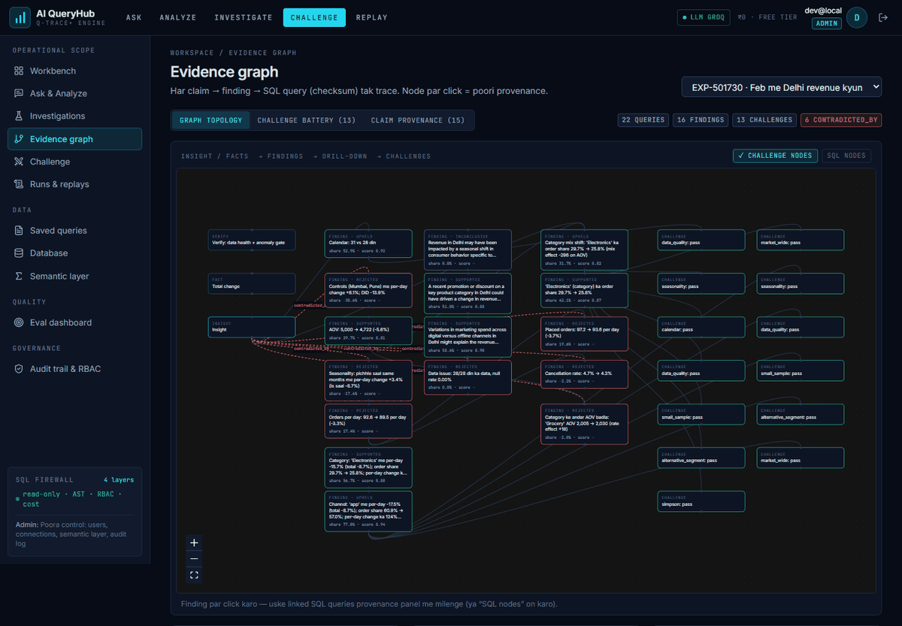

<div align="center">

# AI QueryHub

**Ask your database in plain language, then ask *why*, and get an answer you can audit.**

NL→SQL behind a 4-layer SQL firewall, plus **Q-TRACE+**: a root-cause engine that turns
“Why did Delhi revenue drop in February?” into a reproducible, evidence-graded experiment.

[](https://github.com/Aditya-9753/AI-QueryHub/actions/workflows/ci.yml)


[](https://render.com/deploy?repo=https://github.com/Aditya-9753/AI-QueryHub)



</div>

---

## Why

Most text-to-SQL tools generate a query, run it, and hope it is right. When the question is *why*, they
give you a plausible story with no evidence behind it.

AI QueryHub takes a different approach:

- **Safe by construction.** Every query, whether LLM-written or hand-edited, passes a 4-layer firewall and runs on a read-only connection.
- **The LLM never invents formulas or numbers.** It picks metrics from a governed semantic layer. A grounding validator checks every number in the narrative against SQL results.
- **“Why” questions become experiments.** Hypotheses are generated, tested with statistics, challenged, scored, and recorded with checksums so the run can be replayed exactly.

Workflow: **ASK → ANALYZE → INVESTIGATE → CHALLENGE → REPLAY**

## Features

| Mode | What it does |
|---|---|
| **Ask** | One question → validated SQL → one-line answer + table/chart. Monaco editor for manual SQL (still firewalled). |
| **Analyze** | Breakdowns, trends and two-way splits with a shape-aware chart (ranked bars, share donut, trend with peak/trough, grouped bars or heatmap). Includes deterministic insights (leader share, concentration/Pareto, outliers, biggest move, trend fit), one-click follow-ups, a step-by-step execution trace, a sortable table and CSV export. |
| **Investigate** | Q-TRACE+ root-cause analysis: anomaly gate, variance bridge, hypothesis matrix, evidence graph, grounded narrative. |
| **Challenge** | Re-test any finding: 7-check battery (seasonality, calendar, data quality, sample size, alternative segment, Simpson’s paradox, market-wide) or your own alternative explanation. |
| **Replay** | Exact replay (same SQL → same SHA-256 checksums) or re-derive (re-run the pipeline, diff the findings). Export to JSON / PDF. |

Also included: role-based access (admin / analyst / viewer), a semantic layer editor, saved queries, an audit trail,
an evaluation dashboard, and Supabase / Google login. The UI is a dark, responsive analyst-terminal design that works on desktop and mobile.

<table>
<tr>
<td></td>
<td></td>
</tr>
<tr><td align="center"><sub>Workbench with role-aware access profile</sub></td><td align="center"><sub>Evidence graph: claim → finding → challenge → SQL</sub></td></tr>
</table>

## How Q-TRACE+ works

| Step | Name | What happens |
|---|---|---|
| **V** | Verify | Data-health checks (completeness, nulls, duplicates, freshness), then an ETS / YoY anomaly gate. If the data is broken or the change is within normal noise, the run stops early instead of explaining noise. |
| **Q** | Question | Rule-based parser (LLM fallback) → metric, filters, current vs base period. |
| **T** | Theorize | Hypotheses from four sources: metric tree, templates, dimension drill-down, and optional LLM extras that must map to the semantic layer. |
| **R → A** | Run & Analyze | Priority-queue loop under a query/LLM budget. Log decomposition, mix/rate split, block bootstrap CIs, permutation tests, DiD against control markets. |
| **C** | Correct | Benjamini–Hochberg FDR, reconciliation (parts must add up), Simpson’s-paradox check. |
| **Ch** | Challenge | Automatic 7-check battery on the top findings. Failed checks lower the score or overturn the finding. |
| **E** | Evidence score | Gated score (directional consistency, sample adequacy, significance, effect size, robustness). Weak evidence is labelled *Insufficient*. |
| **X** | Explain | Claim ledger (fact / association / interpretation / recommendation), each tied to evidence node IDs. A grounding validator rejects any unsupported number. |
| **Rec** | Record | Every SQL, its hash, row checksum, dataset version, model version and semantic-layer version are stored, which makes exact replay possible. |

Design decisions and the bugs they fixed: [docs/algorithm-notes.md](docs/algorithm-notes.md)

### SQL firewall (defense in depth)

1. **DB role.** Read-only connection: Postgres `queryhub_ro` (SELECT only) or SQLite `PRAGMA query_only`, plus a statement timeout.
2. **AST rules.** `sqlglot`: a single statement, root SELECT/UNION only, no DML/DDL, function blacklist.
3. **Policy.** RBAC on tables and columns. App tables and system catalogs are hidden, and sensitive columns are blocked.
4. **Cost guard.** Auto `LIMIT`, timeout, and an `EXPLAIN` cost threshold.

## Results

All numbers come from the evaluation suite in this repo (`backend/tests/eval_suite`). The benchmark plants known causes
in synthetic data across 200 scenarios (50 each: mix shift, cancellation spike, missing days, noise only).

| Metric | Value |
|---|---|
| False alarms on noise-only data | **0%** |
| Data-issue detection (missing days) | **100%** |
| Planted cause in top 3 (when the gate fires) | **86%** |
| Planted segment localized (when the gate fires) | **83%** |
| Attribution error (F32) | **0.107** |
| Grounding violations in narratives | **0** |
| Exact-replay reproducibility | **100%** |
| Unsafe SQL blocked (safety suite) | **25 / 25**, with 5 / 5 safe queries passing |
| Avg cost per investigation (deterministic mode) | ~6.6 SQL queries, ~175 ms |

Ablation and calibration (Brier / ECE, 5-fold CV) are on the in-app Eval page.
The 100-question golden NL→SQL accuracy run needs an LLM key and has not been published yet.

## Tech stack

| Layer | Tools |
|---|---|
| Frontend | React 18, Vite 5, TypeScript (strict), Tailwind CSS, Zustand, TanStack Query, Recharts, React Flow, Monaco |
| Backend | FastAPI, SQLAlchemy 2 + Alembic, Pydantic v2, sqlglot, pandas / NumPy / SciPy / statsmodels, fpdf2 |
| LLM | Groq → Gemini → Ollama fallback chain (all optional), Redis response cache |
| RAG | Schema retrieval with ChromaDB + Sentence-Transformers, or a lexical fallback |
| Auth | Local JWT or Supabase Auth (incl. Google OAuth), RBAC |
| Jobs / ops | Celery + Redis (thread fallback), Sentry, GitHub Actions, Render, Docker Compose |
| Data | SQLite (default) or PostgreSQL / Supabase |

## Quick start

**Prerequisites:** Python 3.12, Node 22.

```bash
git clone https://github.com/Aditya-9753/AI-QueryHub.git
cd AI-QueryHub
cp .env.example .env                     # Windows: copy .env.example .env, then fill in keys (optional)

# backend
cd backend
python -m venv .venv
source .venv/bin/activate                # Windows: .venv\Scripts\activate
pip install -r requirements.txt
pip install -r requirements-rag.txt      # optional: ChromaDB + sentence-transformers (~2 GB)
python ../database/seed_data/seed_demo.py   # ~120k demo orders + 5k synthetic customers (Delhi / Mumbai / Pune, Jan 2025 → Feb 2026)
uvicorn app.main:app --reload            # API docs: http://localhost:8000/docs

# frontend (new terminal)
cd frontend
npm install
npm run dev                              # http://localhost:5173
```

Sign up in the app. **The first account becomes admin**, and later accounts become analysts.
Try *“Feb me Delhi revenue kyun gira?”* on the Investigations page. The demo data has a planted Electronics mix shift.

Full stack with Postgres, Redis and Chroma: `docker-compose up --build`

### Configuration

All settings are environment variables (root `.env` or `backend/.env`). See [`.env.example`](.env.example).

| Variable | Default | Notes |
|---|---|---|
| `DATABASE_URL` | `sqlite:///./queryhub.db` | App tables. `postgresql://…` URLs are mapped to the psycopg driver automatically. |
| `READONLY_DATABASE_URL` | `sqlite:///./queryhub.db` | Where user SQL runs. Use a read-only role in Postgres. |
| `GROQ_API_KEY` / `GEMINI_API_KEY` | empty | Optional. Without a key, ASK is unavailable but INVESTIGATE runs fully deterministic. |
| `JWT_SECRET` | `change-me` | **Change this in production.** |
| `CORS_ORIGINS` | `http://localhost:5173` | Comma-separated list or JSON list. |
| `SUPABASE_URL` | empty | Enables Supabase / Google login. |
| `SENTRY_DSN` | empty | Optional error monitoring. |

## Roles

| | Admin | Analyst (investigator) | Viewer (report consumer) |
|---|:---:|:---:|:---:|
| Ask / Analyze in plain language | ✓ | ✓ all business tables | ✓ `orders`, `payments` only |
| Manual SQL in the editor | ✓ | ✓ | – (SQL shown read-only) |
| Run investigations, challenge findings, re-derive | ✓ | ✓ (own runs) | – |
| Exact replay (verify checksums) | ✓ | ✓ | – |
| Read team investigations + evidence, export JSON / PDF | ✓ | ✓ | ✓ (completed runs) |
| `customers` table | ✓ | ✓ (email / phone blocked) | – |
| Sensitive columns (email, phone) | ✓ | – | – |
| Org-wide usage, every user's query log, LLM token usage | ✓ | – | – |
| Create accounts, change roles, deactivate users | ✓ | – | – |
| Connections, metric definitions, audit log, system config | ✓ | – | – |

Every rule is enforced in the backend (`require_role`, ownership checks, SQL policy layer). If a question touches a table or column
that the role cannot see, the answer says so instead of silently returning less. Each role also gets its own
Workbench: a reader view with an ask box and team feed for viewers, an investigator console for analysts, and a
governance panel for admins. The admin **Control center** has five tabs: Overview (queries per day, block rate, usage by role, top
users, LLM tokens per model), Users (create account, role, active), Query log (every user's question + SQL), Audit,
and System (effective config, never secrets). Locked tools are shown with a lock icon, so it is clear what each role can do.

## Tests and evaluation

```bash
cd backend
pytest -q -p no:warnings                                  # 114 tests (hermetic: no real LLM calls)
python -m tests.eval_suite.worked_example                 # blueprint Ch 10 worked example, live pipeline
python -m tests.eval_suite.benchmark --scenarios 200      # planted-cause benchmark
python -m tests.eval_suite.run_ablation --scenarios 60
python -m tests.eval_suite.calibrate                      # run after the benchmark
python -m tests.eval_suite.safety                         # unsafe-SQL suite
python -m tests.eval_suite.run_golden                     # needs an LLM key (100 NL→SQL questions)
```

## Deployment and CI/CD

Each push runs [GitHub Actions](.github/workflows/ci.yml):
- ruff and pytest
- an eval smoke run that must keep 0 grounding violations, 0 false alarms and a 100% safety block rate
- a seed smoke test
- the frontend type-check and build

[`render.yaml`](render.yaml) deploys the API and static frontend to Render’s free tier. Deploys to `main`
happen only after CI passes. Step-by-step guide (Supabase DB, env vars, limits): **[docs/deploy-render.md](docs/deploy-render.md)**

## Project structure

```
AI-QueryHub/
├── backend/
│   ├── app/
│   │   ├── api/routes/        # query, experiments, challenges, evidence, metrics, admin, auth, …
│   │   ├── core/              # settings, security (JWT / Supabase, RBAC)
│   │   └── services/
│   │       ├── orchestrator/  # Q-TRACE+ pipeline (qtrace.py), question parser, ASK
│   │       ├── verify/        # data health + anomaly gate
│   │       ├── analytics/     # decomposition, bootstrap, permutation, DiD, FDR
│   │       ├── challenge/     # 7-check battery, counter-hypotheses
│   │       ├── evidence/      # scorer, claims, grounding validator, graph, provenance
│   │       ├── experiments/   # recorder, runner, replay, export
│   │       ├── sql_validator/ # 4-layer firewall
│   │       ├── llm/  rag/     # provider fallback chain, schema retrieval
│   │       └── …
│   └── tests/                 # unit + API tests, eval_suite/
├── frontend/src/
│   ├── pages/                 # Workbench, Ask & Analyze, Investigation, Evidence graph, Challenge, …
│   └── components/            # design system, charts, qtrace, evidence-graph, layout
├── database/                  # Alembic migrations, schema.sql (Postgres + read-only role), seed data
├── docs/                      # PRD, setup, deploy, algorithm notes, PDF audit, architecture
├── render.yaml                # Render Blueprint (free tier)
└── docker-compose.yml
```

## Documentation

- [Setup guide](docs/setup-guide.md) · [Deploy on Render](docs/deploy-render.md) · [API docs](docs/api-docs/README.md)
- [Algorithm notes and evaluation](docs/algorithm-notes.md): every design decision with before/after numbers
- [Blueprint audit](docs/pdf-audit.md): chapter-by-chapter mapping to the *Master Blueprint v3.0 · Q-TRACE+ Edition*
- [Product requirements](docs/PRD.md) · [Architecture diagram](docs/architecture-diagram.png)
